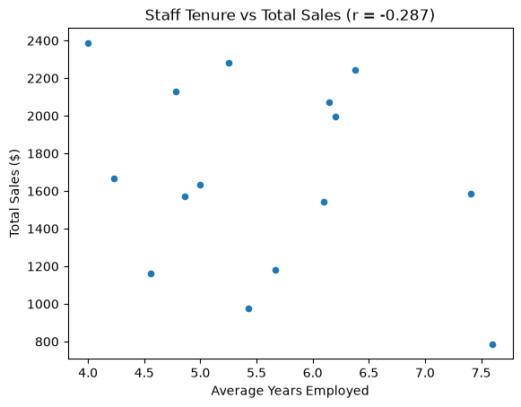
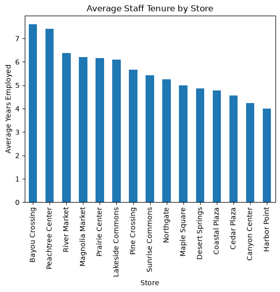

# Retail SQL Analysis

> Does staff experience relate to store sales? A SQL and Python analysis of
> four related retail tables, and a look at why the answer is probably no.

## The Question

Classmates working this dataset tested two things against store sales. Store
square footage came back at r = 0.185. Employee headcount came back at
r = 0.335. Both weak.

Average staff tenure is the obvious third variable and nobody had run it. The
employees table carries `years_employed`, so average tenure per store is a
straight average.

## Results

Tenure and total sales correlate at **r = -0.287**. Negative, which runs
opposite to the hypothesis.

| Store | Region | Avg tenure | Transactions | Avg ticket | Total sales |
|---|---|---|---|---|---|
| Bayou Crossing | South | 7.60 | 7 | $112.42 | $786.96 |
| Peachtree Center | South | 7.41 | 8 | $198.09 | $1,584.73 |
| River Market | Central | 6.38 | 13 | $172.57 | $2,243.46 |
| Magnolia Market | South | 6.20 | 10 | $199.84 | $1,998.44 |
| Prairie Center | Central | 6.15 | 10 | $207.41 | $2,074.11 |
| Lakeside Commons | Central | 6.10 | 7 | $220.20 | $1,541.37 |
| Pine Crossing | East | 5.67 | 8 | $147.84 | $1,182.72 |
| Sunrise Commons | South | 5.43 | 7 | $139.67 | $977.72 |
| Northgate | North | 5.25 | 13 | $175.70 | $2,284.10 |
| Maple Square | East | 5.00 | 8 | $204.24 | $1,633.93 |
| Desert Springs | West | 4.86 | 12 | $131.06 | $1,572.68 |
| Coastal Plaza | West | 4.78 | 12 | $177.59 | $2,131.11 |
| Cedar Plaza | North | 4.56 | 11 | $105.77 | $1,163.52 |
| Canyon Center | West | 4.23 | 10 | $166.59 | $1,665.94 |
| Harbor Point | East | 4.00 | 12 | $199.03 | $2,388.35 |

The longest-tenured store had the lowest sales. The shortest-tenured store had
the highest.



The scatter is a cloud. That matters more than the correlation coefficient
does, and it is the reason the number should not be taken at face value.



Tenure itself spreads from 4.00 to 7.60 years, so the stores do differ
meaningfully on the variable being tested. The question is not whether there
is variation to find a relationship in.

## Why That Result Is Not The Finding

Reading -0.287 as "experience hurts sales" would be wrong, for two reasons.

First, n = 15 stores. A correlation this weak sits inside what random
variation produces at that sample size.

Second, something else explains total sales much better:

| Variable | r vs total sales |
|---|---|
| Transaction count | **0.742** |
| Average sale amount | **0.649** |
| Employee count | 0.335 |
| Average tenure | -0.287 |

Transaction count and average sale amount are independent of each other
(r = -0.009), so they are two separate drivers rather than one restated twice.
Together they account for most of the variation, and tenure is left explaining
noise.

Bayou Crossing shows it plainly. 7 transactions, the lowest average ticket at
$112, and the lowest total. Harbor Point had 12 transactions at $199 and the
highest total. The gap in sales is a gap in volume and ticket size, not in
staff experience.

## The Transferable Part

Store size, headcount, and tenure are all attributes of the store.

Transaction count is a component of the thing being explained. Total sales is
transactions multiplied by average ticket, so of course it tracks them.

Correlating a total against store attributes will usually lose to correlating
it against its own components. Decomposing the metric first is cheap and it
tells you whether an explanatory variable has any room left to explain
anything.

## Method

The data lives in four related CSV files. Pandas loads them into SQLite, SQL
does the joining and aggregation, and the result comes back to pandas as a
DataFrame for charting.

The join needed care. Employees and sales both hang off `store_id`, so joining
them in one pass multiplies rows. A store with 18 employees and 40 sales would
return 720 rows, and every count and sum computed from that would be wrong.

Each side is aggregated separately in a CTE, then the summaries are joined on
`store_id`.

```sql
WITH employee_summary AS (
    SELECT
        store_id,
        COUNT(employee_id) AS employee_count,
        ROUND(AVG(years_employed), 2) AS avg_tenure_years
    FROM employees
    GROUP BY store_id
),
sales_summary AS (
    SELECT
        store_id,
        COUNT(sale_id) AS transaction_count,
        ROUND(SUM(sale_amount), 2) AS total_sales,
        ROUND(AVG(sale_amount), 2) AS avg_sale_amount
    FROM sales
    GROUP BY store_id
)
SELECT
    s.store_name,
    r.region_name,
    e.employee_count,
    e.avg_tenure_years,
    sa.transaction_count,
    sa.avg_sale_amount,
    sa.total_sales
FROM stores AS s
JOIN regions AS r
    ON s.region_id = r.region_id
JOIN employee_summary AS e
    ON s.store_id = e.store_id
JOIN sales_summary AS sa
    ON s.store_id = sa.store_id
ORDER BY
    e.avg_tenure_years DESC;
```

## Data

Four related CSV files in `data/retail`:

- `region.csv` - one row per region
- `store.csv` - one row per store, with square footage and type
- `employee.csv` - one row per employee, with role and years employed
- `sale.csv` - one row per sale transaction, with amount and payment type

15 stores across 5 regions.

## Professional Workflow

See [**Workflow B: Apply Example Project**](https://denisecase.github.io/pro-analytics-02/workflow-b-apply-example-project/)
to get a project like this running on your machine.

## Documentation Index

- **Home** - this landing page
- [**Project Instructions**](./project-instructions.md)
- [**Concepts**](./concepts.md)
- [**Data Card**](./data-card.md)
- [**API**](./api.md)

## Produced Artifacts

- [**Reactive App (marimo)**](https://jgdavis24.github.io/datafun-05-sql/app/)
  - run the analysis interactively in a browser

- [**Reactive Notebook (marimo)**](https://github.com/jgdavis24/datafun-05-sql/blob/main/src/datafun/notebook.py)
  - view the Python source used to create the reactive app
